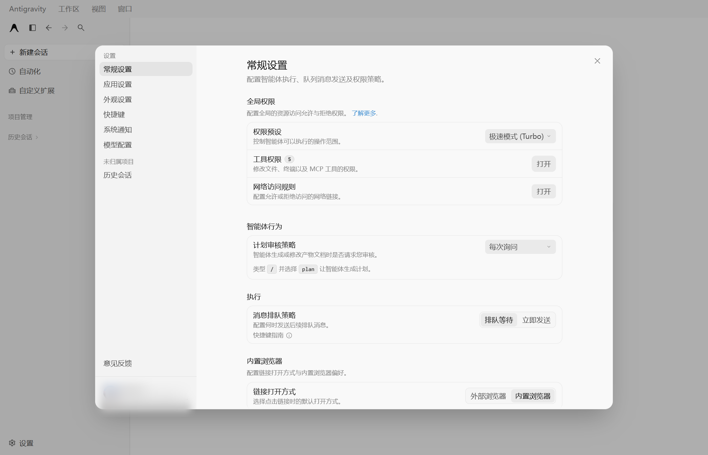
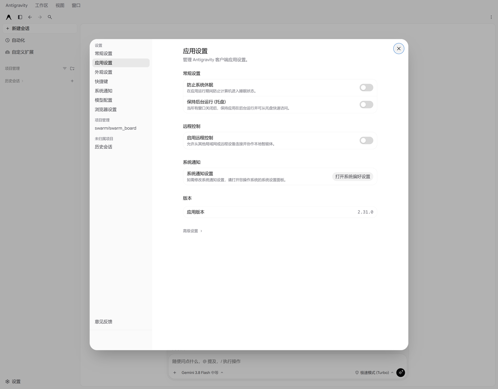

# Antigravity（反重力）中文汉化包

> 把 Google Antigravity 桌面客户端变成简体中文。

**不用管版本。** 你装的官方是哪一版都行——以后官方更新到更新的版本也行。它拿你机器上的
新版文件当底座，把已有译文搬上去，**界面继续是中文，不会退回英文**。

[下载补丁包](https://github.com/bslnssb/antigravity-chinese-pack/releases/latest) ·
[问题反馈](https://github.com/bslnssb/antigravity-chinese-pack/issues) ·
译文基于官方 **2.31.0**

设置面板同样全部中文：

## 版本对不上？这就对了

你看到这个仓库时，官方多半已经比 2.31.0 新了——**不用等我们跟进，直接装就行**：

| 情况 | 结果 |
|---|---|
| 官方 = 2.31.0 | 全中文 |
| 官方比 2.31.0 新 | 启动时把译文搬到新版文件上，界面照旧中文，首次多等几秒 |
| 官方这次新加了几句话 | 那几句暂为英文，其余全中文，下次发版补上 |

搬的是**文字**，不是文件——应用的代码永远是你自己装的那一版，不会缺功能、不会白屏、不会降级。

万一官方这次改动太大搬不动，它会自动退回英文并记下这次失败，不会每次启动都卡。这种情况
就等我们出新版包，或开 [issue](https://github.com/bslnssb/antigravity-chinese-pack/issues) 说一声。

## 安装

1. **下载** Releases 里的 `Antigravity-Chinese-Pack-v2.31.0.zip`，解压到任意文件夹
   （文件名里的 2.31.0 只是打包时的官方版本，不代表只能装在 2.31.0 上）
2. **完全退出** Antigravity（关窗口不算，托盘图标要右键 → 退出）
3. 双击 **`一键安装汉化.bat`**，看到 `[OK]` 后，用桌面新出现的 **「反重力（中文版）」** 启动

首次打开等 30–60 秒中文才全部出现，属正常，别太早下结论。

## 以后怎么用

| 你想要的 | 做什么 |
|---|---|
| 一直中文，跟着官方更新 | 不用管，每次用 **「反重力（中文版）」** 启动就行 |
| 一点都不想被打断 | 双击 `关闭自动更新.bat`（想追新时双击 `恢复自动更新.bat` 撤销） |
| 回到英文原版 | 双击 `一键恢复官方英文.bat`（之后请用 Antigravity 自己的图标启动，否则中文会被补回来） |
| 想临时看英文 | 在窗口里按 `Ctrl+Shift+L` 暂停汉化，再按一次恢复（刷新也记得你的选择） |

官方更新是整目录覆盖，一定会把中文冲掉——这不是装错了。但只要用「反重力（中文版）」
启动，它会自己补回来。哪天发现还是英文，重跑一次 `一键安装汉化.bat` 也就 10 秒。

## 常见问题

**官方版本比本包新，会退回英文吗？**
不会。直接双击「反重力（中文版）」：它会拿新版官方文件做底座，把已有译文搬过去，
界面继续是中文（首次多等几秒）。
千万别手工把旧版 `app.asar.zh-*` 改名覆盖，那是整包降级，可能白屏。

**安装时提示「没有和这一版对应的中文包」？**
官方版本比本包新时是常态。现在安装脚本只给一句提示，照常把桌面启动入口建好，
不会中途退出；直接用「反重力（中文版）」启动，译文会自动搬到新版文件上。

**桌面「反重力（中文版）」点了没反应？**
有些电脑会拦 Windows 脚本宿主（VBS 启动器）。双击解压文件夹里的 `启动反重力.cmd`
或桌面上的 `反重力（中文版）.cmd`，这两条路不依赖脚本宿主，效果一样。

**我没装代理，或用的是别的客户端（不是 Clash 默认的 7897）？**
启动器不认死某个端口：先看包里的 `tools\local-proxy.txt`，再看 Windows 的「系统代理」，
最后才去试几个常见端口（7897 / 7890 / 7891 / 10809 / 1080 / 8080 等）。**试的时候会先验证
对方到底是不是代理**，所以哪怕 8080 上正跑着开发服务器，也不会被误当成代理。
一个都没探到就一个网络设置都不动，效果和直接双击官方图标一样（只是国内直连登不上 Google）。
端口不常见、或代理在另一台机器上：新建 `tools\local-proxy.txt`，写一行
`127.0.0.1:你的端口` 或 `192.168.1.5:7890`，下次启动就用它；写错也不影响启动，会继续往下探。

**登录页报「设置账户出现问题」、还全是英文？**
多半不是汉化坏了，是 **Google 登录连不上**：客户端后台要访问 `oauth2.googleapis.com`，
国内直连会超时。请用桌面「反重力（中文版）」启动（**别用 Antigravity 官方图标**），
只有前者会把本地代理同时传给浏览器和后台进程。还不行就在代理软件里换个可用节点，
或开 TUN / 全局模式；启动器会把探测结果写进 `%TEMP%\antigravity-launch.log`
（`PROXY_HEALTH=True/False`）。
另外，**已经开着的窗口不会重新读取磁盘上的 asar**：官方更新或重装中文包后，
先完全退出客户端再启动，否则看到的仍是旧界面（全英文）。

**更新后界面变英文了？**
正常，整目录覆盖的必然结果。用「反重力（中文版）」再启动一次，它会把译文重新搬过去；
还不行就重跑 `一键安装汉化.bat`。

**会把软件搞坏、开不了吗？**
不会。最差的结果是变回英文——官方更新会整目录覆盖，坏补丁留不下来。

**装在 `C:\Program Files` 下装不上？**
那里需要管理员权限。右键 `一键安装汉化.bat` → **以管理员身份运行**。
默认位置（`%LOCALAPPDATA%\Programs`）没有这个问题。

**会被封号吗？**
不会。只改本地界面的文字，不动账号、不上传任何数据。

## 许可

MIT（见 `LICENSE`），仅覆盖本仓库的脚本与译文材料。

本项目的汉化包基于上游项目 [ATopos-svg/antigravity-chinese-community-pack](https://github.com/ATopos-svg/antigravity-chinese-community-pack)（MIT）修改而来，谨致谢意；上游版权归其作者所有。

本仓库不含 Antigravity 本体及其 `app.asar`，版权归 Google 所有；汉化成品只在 Releases
以补丁包形式提供，请自行备份后用于个人本地界面翻译，并支持官方正版。

---

自愈机制怎么工作、现场移植原理、词条维护流程、目录结构 → [维护者手册](docs/MAINTAINER.md)
