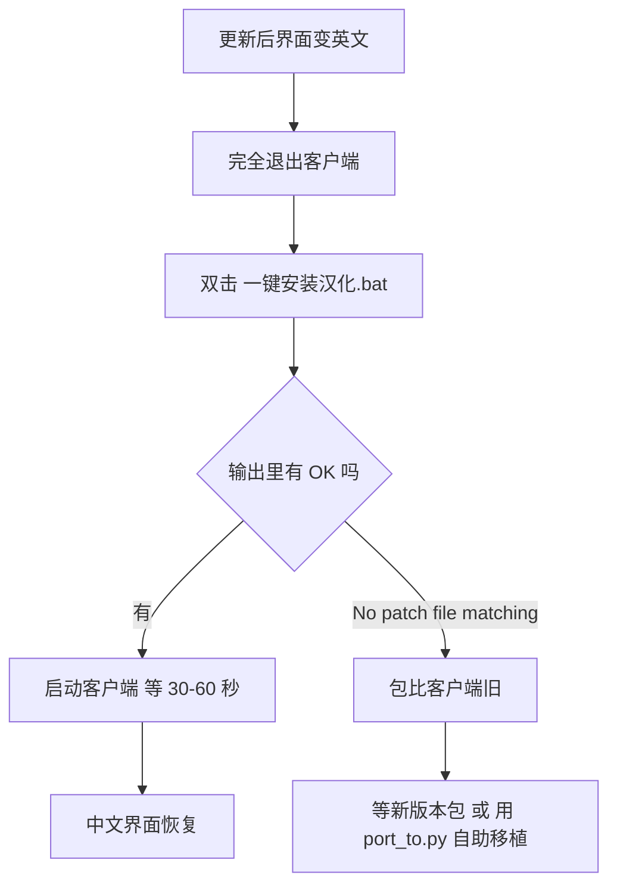

# Antigravity（反重力）中文汉化包

> Google Antigravity（中文社区常称「反重力」）桌面客户端的简体中文汉化补丁。不降级、可校验、一键回滚、可关掉自动更新。
>
> 关键词：反重力汉化 · Antigravity 汉化 · Antigravity 中文 · 界面汉化 · 中文补丁 · Chinese localization pack

当前支持：**官方 2.28.2**（只对这个版本有效，旧版本包见 [版本动态](#版本动态)）

> **已经装过、更新后变英文了？**
> 退出客户端 → 双击 `一键安装汉化.bat` → 启动。详细步骤见
> [升级后又变英文了：怎么恢复](#升级后又变英文了怎么恢复)。

## 界面预览

| 主界面 | 设置页 |
|---|---|
|  |  |

（截图取自 2.28.2 实机，左侧历史会话标题已模糊处理。个别官方新增文案可能仍显示英文，
遇到可在 Issues 反馈。）

## 先说清楚：它是什么，代价是什么

**它做的事**：把客户端 6 个界面文件里的英文换成中文（含 1283 条运行时词条），
以你本机官方 `app.asar` 为底座，不降级、不改功能、不联网。

**它的代价**：这是**改本地文件**。官方每次全量更新都会把 `resources\` 覆盖一遍，
`app.asar` 变回英文，备份也一起删掉。想长期保住中文，只有两条路——关掉自动更新
（等于放弃自动追新），或每次更新后花 10 秒重装一次。

**适合**：英文界面看着吃力、不追新版本的人。
**不适合**：每天都要最新功能的人。也别指望它能"自动跟着官方升级"——没有任何 asar
补丁做得到，那是这类方案的天花板，不是这一家的缺陷。

## 安装（首次，2 步约 30 秒）

1. **完全退出** Antigravity（关窗口不够，托盘图标要右键退出）
2. 双击 **`一键安装汉化.bat`**，看到 `[OK]` 后启动客户端

> 首屏要水合 30–60 秒，中文才全部出现。刚打开时还有英文是正常的，别太早下结论。

推荐紧接着再双击一次 **`关闭自动更新.bat`** —— 这样以后就不用再来一遍升级恢复流程了
（可撤销，想追新时运行 `恢复自动更新.bat`）。

**回滚**：双击 `一键恢复官方英文.bat`（自动识别 `app.asar.backup` / `app.asar.bak`）。

## 升级后又变英文了：怎么恢复

官方更新是**全量安装包**，会把 `resources\` 整个覆盖掉，`app.asar` 变回英文，
连 `app.asar.backup` 都会被删。所以升级后变英文，是必然，不是装错了。



### 三步，10 秒

```
第 0 步  完全退出客户端（托盘图标右键 → 退出）。进程没退干净，文件被占用，覆盖会失败
第 1 步  双击 一键安装汉化.bat，看到 [OK] Chinese pack applied 即成功
第 2 步  启动客户端，等 30–60 秒水合
```

脚本会自动完成：定位安装目录 → 从 `Antigravity.exe` 读出已装版本 → 挑出同版本的
`app.asar.zh-<版本>` → **把当前官方 asar 备份成 `app.asar.backup`** → 覆盖。

注意第二条：升级把旧备份删了，脚本会用**新版官方 asar** 重建备份。所以回滚能力自动恢复，
但只能回到**当前这个新版**，回不到升级前的旧版。

### 怎么确认恢复了

```bat
findstr /m /c:"__agyTranslateText" "%LOCALAPPDATA%\Programs\Antigravity\resources\app.asar"
```

- 打印出 `...\app.asar` → 汉化版在位
- 什么都不打印 → 还是官方英文版，没装成功

也可以看文件大小：官方 2.28.2 约 4.6 MB，汉化版约 4.9 MB（多出的部分是翻译引擎）。
再确认备份有没有重建：

```bat
dir "%LOCALAPPDATA%\Programs\Antigravity\resources\app.asar*"
```

应该能看到 `app.asar` 和 `app.asar.backup` 两个文件，大小不同。

### 如果脚本提示 `No patch file matching this Antigravity version`

完整输出长这样：

```
 [ERROR] No patch file matching this Antigravity version.
         Installed: 2.29.0.0
```

说明官方版本已经跑到本仓库前面了，包里没有对应版本的补丁。这时**不要**硬装旧版补丁
——版本对不上会白屏或卡 Loading。

| 你的情况 | 怎么做 |
|---|---|
| 不急着要新功能 | 先双击 `一键恢复官方英文.bat` 回到干净的英文版（可选），等本仓库跟进发布 |
| 想要中文，也能动手 | 克隆本仓库，`python tools/port_to.py --version <你的版本>`，产物改名 `app.asar` 放进 `resources\`（[详细步骤](#官方比本包新怎么办)） |
| 必须马上有中文 | 官方不提供历史版本下载，只能等发布或自助移植；本包不做降级安装 |

### 两个常见误操作

- **客户端没退干净就运行**：报 `Copy failed`。没有破坏性后果，把客户端退干净重跑即可。
- **在没有备份的情况下重复运行**：脚本发现"当前文件大小和补丁一样"，会提示
  `Current app.asar looks like a patched file` —— 意思是它拿不到干净的官方原件，也就没法建备份。
  之后想回滚只能重装客户端。已有 `app.asar.backup` 时不会发生，脚本会保留原备份。

## 三种策略，按需选一

| 方案 | 怎么做 | 汉化能活多久 | 能拿到新功能吗 |
|---|---|---|---|
| **A. 关掉自动更新**（推荐） | 双击 `关闭自动更新.bat` | 一直有效（除非你手动更新） | 想更新时手动更新 |
| **B. 正常更新，更新后重装** | 更新完双击 `一键安装汉化.bat` | 重装后复活 | 自动拿到 |
| **C. 版本跳了，自己重做补丁** | 克隆仓库 + `python tools/port_to.py --version <你的版本>` | 跟到最新 | 自动拿到 |

### 方案 A：关掉自动更新（一次设置，之后不用再管）

客户端自带一个官方设置 `autoCheckForUpdates`（默认 `true`），存在
`%APPDATA%\Antigravity\app_storage.json`。把它设为 `false` 后，主进程会直接
`stopAutoUpdateChecks()` —— **不再发任何更新请求，也就没有东西能覆盖你的 `app.asar`**。

双击就完事：

```bat
关闭自动更新.bat
```

脚本会先确认客户端已退出、备份 `app_storage.json`，再写入这个键（UTF-8 无 BOM，写完自动回读校验）。
想恢复自动更新，双击 `恢复自动更新.bat` 即可，官方默认值立刻回来。

- 这是官方代码里的正规设置，不是 hack，不改动 `app.asar`
- 关掉后仍可**手动**检查更新（应用菜单里的 Check for Updates），只是不会自动下载
- 代价：不会自动拿到新版功能和安全修复。想追新时，先双击 `恢复自动更新.bat`，
  更新完再跑 `一键安装汉化.bat`，就回到方案 B

## 为什么选这个包（和其他汉化包的区别）

社区流行的汉化包大多提供**整个替换版 `app.asar`**。它有个致命问题：如果你安装的 Antigravity
比汉化包新，替换后软件会被**静默降级**，轻则功能缺失，重则配置不兼容。

本包反着来：**以你自己电脑上的官方 `app.asar` 为底座，只替换 6 个界面文件，并重算 Electron
的 integrity 完整性哈希**。因此：

| | 整包替换型汉化 | 本包 |
|---|---|---|
| 版本不匹配时 | 软件被降级 ⚠️ | 拒绝安装并提示，永不降级 ✅ |
| 完整性校验 | 多数未重算，可能报损坏 | 逐文件重算，启动自检通过 ✅ |
| 回滚 | 要自己找官方包 | 双击 `一键恢复官方英文.bat` ✅ |
| 官方更新后 | 一样被冲掉 | 一样被冲掉，但能一键关掉（见方案 A）⚠️ |
| 新版本发布 | 等作者重发整包 | 有新版包就双击装；没有就自己重做一份（需仓库 + Python）⏳ |

## 原理：官方更新为什么会让汉化消失

Antigravity 用的是 electron-updater + **NSIS 全量安装包**更新：新版本会下载一个约
160 MB 的 `Antigravity-x64.exe`，退出时运行它，把整个安装目录覆盖一遍。
`resources\` 里的 `app.asar` 被换成新版官方文件，**你加的 `app.asar.backup` 也一并被清掉**。

节奏是这样的（从本机 `main.log` 实录）：

```
[23:20:09] Starting auto update checks      ← 启动 10 秒后开始检查
[23:20:11] Update available: 2.28.2         ← 2 秒后收到新版本
[23:20:32] Update downloaded: 2.28.2        ← 21 秒下完 160 MB
[23:21:xx] 你重启客户端 → 汉化没了
```

启动后每小时都会再查一次。官方不认识你改过的文件，覆盖就是它的正常行为——
**但这件事是可以关掉的，见方案 A。**

## 官方比本包新怎么办

先看 Releases 有没有对应版本的新包（**首选，双击即装**）。没有的话，不用等发版，
自己 30 秒就能做出一份 —— 这一步需要完整仓库（发布包里不含移植器）和 Python 3：

```bash
git clone <本仓库> && cd antigravity-chinese-pack

# 1. 先备份官方原版（更新会删掉它，第一次一定要做）
copy "%LOCALAPPDATA%\Programs\Antigravity\resources\app.asar" ^
     "%LOCALAPPDATA%\Programs\Antigravity\resources\app.asar.backup"

# 2. 用已安装的客户端作为底座，自动搬运译文并重打包
python tools/port_to.py --version 2.29.0
```

产物是 `build/app.asar.zh-2.29.0`，改名为 `app.asar` 放进 `resources\` 即可。
脚本会自动：抽出官方 6 个文件 → 套用译文记忆 → 补译官方新增文案 → 重算 integrity → 自检。

只在 Windows、只依赖 Python 3（不需要 Node.js）。原理见
[`Antigravity-中文汉化-AI操作手册.md`](Antigravity-中文汉化-AI操作手册.md)。

## 汉化覆盖范围

- 应用菜单 / 托盘菜单 / 安装向导 / 主进程提示，全部完成
- 界面层内置 **1283 条运行时翻译字典**（设置、自动化、插件、技能、账户等界面文案）
- 登录页、设置页、主界面、侧栏均为中文；专有名词（Antigravity、Gemini、Google）保持原样

## 仓库结构

```
tools/port_to.py                移植器：把译文搬到新版官方 asar（纯 Python）
tools/preload-engine.js         固定的翻译引擎（词典 + DOM 翻译器）
tools/porting-rules.json        人工补译规则（官方新增文案、代码拼接片段）
tools/auto-update-toggle.ps1    官方 autoCheckForUpdates 开关的实现（防更新冲掉补丁）
tools/maintainer/zh_merge.py    asar 读写 / integrity 重算 / 打包自检
tools/patches/                  换装映射、翻译字典、历次安装说明
build/work-2.26/zh26/           2.26 的 6 个换装源文件
build/work-2.28.2/              2.28.2 的官方原始件与换装成品
一键安装汉化.bat                 一键安装（自动识别版本 + 自动备份）
关闭自动更新.bat                 关掉官方自动更新，让汉化一直存活（可撤销）
恢复自动更新.bat                 恢复官方默认：启动 10 秒后检查、每小时复查
一键恢复官方英文.bat             一键回滚到英文原版
Antigravity-中文汉化-AI操作手册.md  完整可复现流程（asar 结构、踩坑清单）
```

## 版本动态

- **2.28.2**（2026-11-01）：跟随官方 2.28.2；修复译文误改代码标识符导致启动崩溃的问题；
  补译登录页 3 条新文案；新增 `一键安装汉化.bat`、`关闭自动更新.bat`、`tools/port_to.py`
- **2.26.0**（2026-10-25）↔ 官方 2.26.0
- **2.25.1**（2026-10-25）↔ 官方 2.25.0

官方默认自动更新，会把 `app.asar` 覆盖回英文并删掉备份。想一劳永逸就运行一次
`关闭自动更新.bat`；想继续追新就更新完再运行 `一键安装汉化.bat`。

## 常见问题

**Q: 更新后界面变回英文了？**
A: 正常现象，官方全量安装覆盖了 `app.asar`。见 [升级后又变英文了：怎么恢复](#升级后又变英文了怎么恢复)
——退出客户端，双击 `一键安装汉化.bat` 即可。备份也被删了的话，脚本会从当前这份官方 asar 重新建一个。
**想彻底避免，就先运行一次 `关闭自动更新.bat`。**

**Q: 更新后我的备份被删了，还能回滚吗？**
A: 能。重跑一次 `一键安装汉化.bat`，它会用新版官方 asar 重建 `app.asar.backup`，之后
`一键恢复官方英文.bat` 照常可用。只是备份对应的是**升级后的版本**，不是升级前那个。

**Q: 关掉自动更新后，会不会错过什么？**
A: 不会错过任何你不想错过的东西——它只停掉了后台自动检查。应用菜单里的
Check for Updates 仍可手动更新；想恢复自动更新，双击 `恢复自动更新.bat`。
唯一的影响是：新版功能和安全修复需要你自己动手更新一次。

**Q: 关掉自动更新算不算"改动官方文件"？**
A: 不算。`autoCheckForUpdates` 是官方 `settingsService` 里定义的设置项，
写的位置也是官方自己的配置文件 `%APPDATA%\Antigravity\app_storage.json`，
`app.asar` 一个字节都没动。

**Q: 替换后启动白屏 / 卡在 Loading？**
A: 说明补丁版本和客户端版本不一致。先双击 `一键恢复官方英文.bat` 回滚，
再确认版本：如果客户端版本比本包新，见 [官方比本包新怎么办](#官方比本包新怎么办)。

**Q: 会不会因为更新把汉化搞坏、连客户端都起不来？**
A: 不会。官方是整目录覆盖，`app.asar` 被换成全新的官方文件，坏掉的补丁不会残留。
最坏的结果就是变回英文，不会变成打不开。

**Q: 会被封号吗？**
A: 汉化只改本地界面文件，不上传任何数据，不影响账号。

**Q: IDE 部分（VS Code 套壳）也汉化了吗？**
A: 桌面客户端已汉化；IDE 侧建议走官方 NLS 语言包方案（本仓库暂不含）。

## 许可

MIT（见 `LICENSE`），**仅覆盖本仓库内本项目编写的脚本与译文材料**。

本仓库不包含 Antigravity 本体及其 `app.asar`。Antigravity 及其二进制文件的版权归 Google 所有；
汉化成品（`app.asar` 形式）只在 Releases 以补丁包形式提供，请自行备份后用于个人本地界面翻译，
并支持官方正版。
