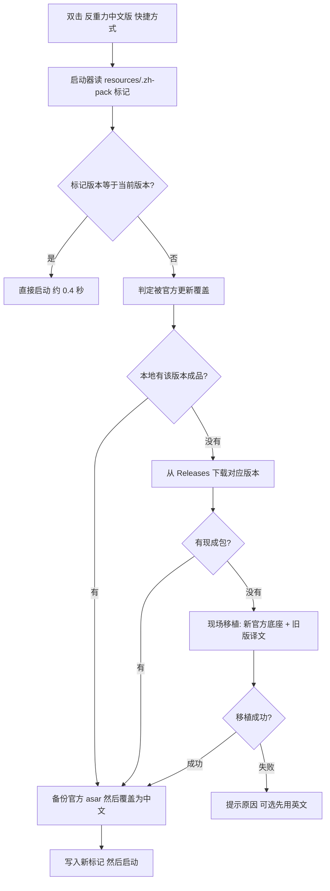

# 维护者手册

面向要改包、补译、跟版本的人。普通用户只需要看 [README](../README.md)。

---

## 1. 原理：官方更新为什么会让汉化消失

Antigravity 用的是 electron-updater + **NSIS 全量安装包**更新：新版本会下载一个约
160 MB 的 `Antigravity-x64.exe`，退出时运行它，把整个安装目录覆盖一遍。
`resources\` 里的 `app.asar` 被换成新版官方文件，**你加的 `app.asar.backup` 也一并被清掉**。

本机 `main.log` 实录的节奏：

```
[23:20:09] Starting auto update checks      ← 启动 10 秒后开始检查
[23:20:11] Update available: 2.28.2         ← 2 秒后收到新版本
[23:20:32] Update downloaded: 2.28.2        ← 21 秒下完 160 MB
[23:21:xx] 你重启客户端 → 汉化没了
```

启动后每小时再查一次。官方不认识你改过的文件，覆盖就是它的正常行为。

官方包里**没有 i18n 资源**（1085 个文件里没有任何 locale 目录），界面字符串直接写死在
`app.asar` 的 6 个 JS 文件里，所以汉化只能在 asar 层面做，也必然会被整目录覆盖冲掉。

## 2. 自愈：靠标记判断，不靠猜

`resources\.zh-pack` 记着四行：`version` / `size` / `applied` / `source`。
官方更新把整个 `resources\` 换掉，标记跟着消失；就算只换 `app.asar`，大小对不上也会被发现。



`-Check` 走快速路径（本机实测 374 ms），不匹配才进 `-Heal`。

**自愈失败一律放行启动**——最差就是这次先看英文，绝不会因为补丁问题让应用打不开。
失败原因写进 `%TEMP%\antigravity-launch.log`，退出码分档：

| 退出码 | 含义 | 启动器怎么反应 |
|---|---|---|
| 10 | 找不到安装目录 | 提示后照常启动 |
| 11 | 读不到客户端版本号 | 提示后照常启动 |
| 20 | 该版本无包且现场移植失败 | 提示「先看英文」后启动 |
| 21 | 下载失败 | 提示后启动 |
| 22 | 包解不开 / 大小或哈希不符 | 提示后启动 |
| 30 | 无写权限（装在 `C:\Program Files`，当前账户改不了） | 提示右键「以管理员身份运行」`一键安装汉化.bat`，然后照常启动 |
| 31 | `app.asar` 被占用（客户端没退干净）或覆盖被拒 | 提示先彻底退出，再照常启动 |

`30` 是 `Program Files` 场景下最常见的一条：Windows 默认不让普通账户改
`C:\Program Files` 下的文件，**唯一办法是提权跑一次安装脚本**。`一键安装汉化.bat`
在算出目录后立刻做同样的写探针（`.zh-write-probe`），写不进去就直接报真因并退出，
不再让用户看着一堆 "Copy failed" 猜。

### 2.1 代理：探到才设，探不到就不动

启动器不写死任何端口（早期版本写死了作者本机的 Clash 端口，别人换端口就永远走错门，
探不到还会弹框）。现在 `DetectProxy()` 按顺序试三个来源，**探到才**给客户端加
`--proxy-server` 并设 `HTTP_PROXY/HTTPS_PROXY/ALL_PROXY`（大小写各一组）+ 清空 `NO_PROXY`：

| 顺序 | 来源 | 说明 |
|---|---|---|
| 1 | `tools\local-proxy.txt` | 本机专用，一行 `[host:]port`。**不进 git、不进 zip**（`.gitignore` 已排除） |
| 2 | Windows 系统代理 | 只在 `HKCU\...\Internet Settings` 的 `ProxyEnable=1` 时采信 `ProxyServer` |
| 3 | `tools/detect-proxy.ps1` | 一次 PowerShell 扫 7897/7890/7891/10808/10809/1080/8080/2080/8888，打印第一个在监听的 |

**探不到就一个网络设置都不动**：不设环境变量、不加 `--proxy-server`、不弹框，
只在 `%TEMP%\antigravity-launch.log` 写一行 `proxy = none`。
端口列表只是候选，不是"必须"：要加候选改 `tools/detect-proxy.ps1` 的 `$ports`；
只想给自己这台机器指定端口，写 `tools\local-proxy.txt`（别提交）。

## 3. 现场移植

官方更新到 N+1、本仓库的 N+1 包还没发布时，用**新版本官方 asar 做底座，把旧版本的译文搬过去**。

- **不拿旧版汉化 asar 直接覆盖**：那会把应用代码一起降级，轻则缺功能、重则白屏。
  移植只搬「英文→中文」的字符串替换对，代码全部来自新版官方
- **不要求用户装 Python / Node**：借 Antigravity 自带的 Electron 当运行时
  （`ELECTRON_RUN_AS_NODE=1`，本机实测 v24.21.0），几百行 JS 就够
- **译文来源**：包内 `tools/patches/memory-*.json`，是「旧版官方原文 → 旧版中文」的替换对。
  本仓库用 2.28.2 的记忆做产物，与手工维护的成品**逐字节等价**
  （唯一差异是 CRLF/LF 归一化后为 0）
- **只替换字符串字面量**，并做单词边界检查——否则 `isExiting` 会被换成一个语法合法、
  运行时才报 `ReferenceError` 的标识符。打包前还会断言代码区不含中文
- **整个过程 2–4 秒**，产物重算 Electron integrity，装完自检"只有 6 个文件变了"

移植失败会自动回滚到官方英文版，并写 `%LOCALAPPDATA%\Antigravity\zh-port-skip`
记下"这个版本别再自动移植"，避免陷入"每次双击都等几秒然后失败"的死循环。删掉该文件可重试。

## 4. 覆盖率的保证方式

这套翻译最容易出的问题不是「漏翻」，而是**翻了半截**：`Built-in Browser Settings`
变成 `Built-in 浏览器设置`，`Legal Help` 变成 `Legal 帮助`。英语短词是长词的前缀，
替换时一旦不看词边界就会啃掉别人。

改完必跑的五道检查：

```
node   scripts/scan_ui.js              连运行中客户端的 CDP，列出未翻译 / 半中半英
node   scripts/test_engine.js          引擎回归（41 个用例，钉死这类事故）
python scripts/merge_dict.py           把 tools/patches/ui-extra.json 合并进引擎
python scripts/rebuild_preload.py      只替换 asar 里的 preload，秒级重打包
python scripts/check_docs.py           文档 ↔ 代码对表（机制被改名/删掉就报错）
node   scripts/shot_settings.js        截设置面板若干页到 build/shots/，供 README 用
```

`check_docs.py` 是**防"文档还说成立"**的那一道：它把文档里的承诺逐条到代码里找证据——
启动器的 `RevertPort` 回滚、`zh-port-skip` 熔断、自愈的 7 个退出码、`.zh-pack` 标记、
恢复脚本删标记、安装脚本的写探针、`PAYLOAD_FILES` 里的每个文件、用例数、代理探测、
哈希校验、Release 模板占位符。任一句已经不成立就退 1，别绕过它，去改代码或改文档。

> 截图脚本截图后要手工糊掉左下角账号区（含邮箱），别把个人信息带进仓库。

补词只改 `tools/patches/ui-extra.json`，不动引擎源码：

- `exact` —— 整串完全相等才替换。**单词一律放这里**，它绝不进句子中间
- `phrase` —— 句内局部替换，带词边界。只放多词短语

引擎的两条铁律：

1. 每个词条编译成带边界的正则（首尾是字母数字时要求前后不是字母数字），
   所以 `Close` 不会命中 `Closed`
2. 纯单词词条不参与句内替换，只做整串匹配，所以 `Browser`（译作「浏览器设置」）
   不会把 `Built-in Browser Settings` 啃成 `Built-in 浏览器设置`

**第三类坑：DOM 被拆成多个文本节点。** 像
`Also includes <a>global permissions</a> when working in these conversations.`
这种句子，整句词典永远对不上，但**不能**拆成短语塞进 `phrase` 表——
短语替换跑在前面，会把 `Also includes global settings when working` 那种完整句
提前啃成「此外还包含 global settings …」。只能在引擎 1.4 区按「整节点恰好相等」锚定。

扫描脚本读 `%APPDATA%\Antigravity\DevToolsActivePort` 拿实时端口，端口每次启动都变。
写自动化时注意：启动客户端和扫描必须在**同一条命令**内跑完，否则进程会被清理，
表现为 `ECONNREFUSED`（不是包的问题）。

## 5. 自己给新版本做包

先看 Releases 有没有对应版本（首选，双击即装）。没有的话，30 秒能做出一份——
需要完整仓库和 Python 3：

```bash
git clone <本仓库> && cd antigravity-chinese-pack

# 1. 先备份官方原版（更新会删掉它，第一次一定要做）
copy "%LOCALAPPDATA%\Programs\Antigravity\resources\app.asar" ^
     "%LOCALAPPDATA%\Programs\Antigravity\resources\app.asar.backup"

# 2. 用已安装的客户端作为底座，自动搬运译文并重打包
python tools/port_to.py --version 2.29.0
```

产物是 `build/app.asar.zh-2.29.0`，改名为 `app.asar` 放进 `resources\` 即可。
脚本会自动：抽官方 6 个文件 → 套译文记忆 → 补译新增文案 → 重算 integrity → 自检。

发版：

```bash
python scripts/package_dist.py --version 2.29.0   # → packs/Antigravity-Chinese-Pack-v2.29.0.zip
python scripts/upload_release.py --version 2.29.0 # 删同名旧资产并上传
```

`package_dist.py` 除了打 zip，还会：

1. 打印 **zip 和 asar 两个 SHA256**（asar 是包内汉化文件），照抄进 Release 正文；
2. 写 `tools/patches/sha256-<版本>.json`（`asar_size` + `asar_sha256`）并**打进包里**——
   自愈在覆盖 `app.asar` 前会拿它比对，下载半截、缓存被改坏的包会被拦下（退出码 22），
   不会装上去才崩。这张表是随版本固化的，**别手改**；成品变了就重新跑一次。
   包里没有这张表（老版本包）时不拦，向后兼容。
3. 用 `docs/release-body.md` 模板渲染出 `build/_release-body-v<版本>.md`（`build/_*` 不进 git），
   正文里已经有「本版变化」和「下载与校验」两节，发版前补上本版变化即可。

## 6. 仓库结构

```
tools/preload-engine.js         固定的翻译引擎（词典 + DOM 翻译器）
tools/patches/ui-extra.json     补词表（exact / phrase 两个分区）
tools/patches/memory-*.json     「旧版官方原文 → 中文」替换对，移植用的素材
tools/patches/sha256-*.json     各版 asar 的尺寸 + SHA256（package_dist.py 生成，随包发布）
tools/porting-rules.json        人工补译规则（官方新增文案、代码拼接片段）
tools/port/port.js              现场移植器：新版官方底座 + 旧版译文
tools/port_to.py                移植器（纯 Python 版，本地开发用）
tools/selfheal.ps1              自愈：比对 .zh-pack 标记后自动补回
tools/detect-proxy.ps1          本地代理端口探测（候选端口清单在这里，别写进启动器）
tools/maintainer/zh_merge.py    asar 读写 / integrity 重算 / 打包自检
tools/auto-update-toggle.ps1    官方 autoCheckForUpdates 开关
tools/find-install-dir.ps1      自定义安装目录兜底（注册表 UninstallString 反推）；
                                -SetFile 把结果按 936 写成 set 语句给 bat call
tools/make-shortcut.ps1         生成桌面「反重力（中文版）」快捷方式
tools/redact_screenshots.py     README 截图打码
scripts/                        维护链（扫描 / 回归 / 合并 / 重打包 / 发版）
scripts/check_docs.py           文档 ↔ 代码对表：声称的机制必须真在代码里（退 1 = 有不符）
docs/release-body.md            Release 正文模板（package_dist.py 用它渲染草稿）
build/work-*/                   各版本的官方原始件与换装成品
一键安装汉化.bat                 安装（识别版本 + 备份 + 建快捷方式）
启动反重力.vbs                   无黑窗启动器：探到本地代理才设代理、查自愈状态后拉起客户端
关闭自动更新.bat / 恢复自动更新.bat
一键恢复官方英文.bat             回滚：找备用 asar 复制回去 + 删 .zh-pack 标记
```

## 7. 和其他汉化包的区别

社区流行的汉化包大多提供**整个替换版 `app.asar`**。它有个致命问题：如果你安装的
Antigravity 比汉化包新，替换后软件会被**静默降级**，轻则功能缺失，重则配置不兼容。

本包反着来：**以本机官方 `app.asar` 为底座，只替换 6 个界面文件，并重算 Electron
的 integrity 完整性哈希**。

| | 整包替换型汉化 | 本包 |
|---|---|---|
| 版本不匹配时 | 软件被降级 ⚠️ | 拒绝安装并提示，永不降级 ✅ |
| 完整性校验 | 多数未重算，可能报损坏 | 逐文件重算，启动自检通过 ✅ |
| 回滚 | 要自己找官方包 | 双击 `一键恢复官方英文.bat` ✅ |
| 官方更新后 | 一样被冲掉，只能手动重装 | 一样被冲掉，但下次启动**自动补回** ✅ |
| 新版本发布 | 等作者重发整包 | 有新版包就双击装；没有就现场移植 ✅ |

## 8. 手工排查

确认补丁是否在位：

```bat
findstr /m /c:"__agyTranslateText" "%LOCALAPPDATA%\Programs\Antigravity\resources\app.asar"
```

- 打印出 `...\app.asar` → 汉化版在位
- 什么都不打印 → 还是官方英文版

看自愈状态：

```powershell
powershell -ExecutionPolicy Bypass -File tools\selfheal.ps1 -Check
```

输出 `官方已更新到 x.y.z，需要重新打中文补丁` 说明标记已不匹配，
把 `-Check` 换成 `-Heal` 立刻补好。

文件大小对照：官方 2.28.2 约 4.6 MB，汉化版约 4.9 MB（多出来的是翻译引擎）。

### 8.1 写 bat 时容易踩的两个坑

- **PowerShell 5.1 的输出编码和 `for /f` 对不上**。PS 把 stdout 写进管道/文件时是
  UTF-8，而 cmd 的 `for /f` 拿到的是 ANSI(936) 字节。安装路径里只要有一个中文字符
  （用户名是中文就一定会有），两边就对不上，随后的 `if exist` / `copy` 全部失败，
  兜底等于没兜住。所以 `find-install-dir.ps1` 有 `-SetFile`：把结果按 936 写成
  `set "RT=..."` 到临时文件，bat 用 `call` 读回来。
- **`( )` 块里 echo 未加引号的路径会炸**。`C:\Program Files (x86)\...` 里的右括号
  会提前结束 if/for 块，报 `... was unexpected at this time`。要么把路径用引号包起来，
  要么把这些 echo 挪出块、用 `goto` 跳转。
